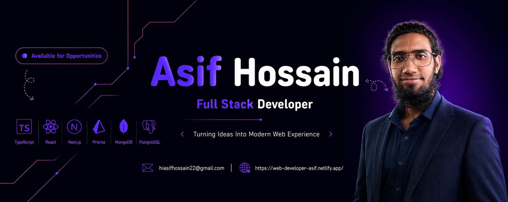

<!-- Banner -->

  

📍 Dubai, United Arab Emirates 
🌍 Open to Remote Opportunities

---

# About Me

I'm a **Full Stack Web Developer** passionate about building responsive, user-friendly and scalable web applications that solve real-world problems.

My journey into web development began in December 2022, driven by a dream I've had since 2019. While working abroad as an Office Assistant, I invested my savings in my first laptop and started turning that dream into a practical skill. That experience taught me the value of discipline, consistency, adaptability and learning through challenges.

### What I Do

- **Frontend Development:** Building responsive and accessible user interfaces with HTML, CSS, Bootstrap, Tailwind CSS, JavaScript and React.
- **Backend Development:** Developing server-side applications and RESTful APIs using Node.js, Express.js and TypeScript.
- **Databases & ORM:** Working with MongoDB and PostgreSQL with Prisma for type-safe database access.
- **Modern Web Development:** Expanding my expertise in Next.js, application architecture, API integration, authentication and full-stack development practices.

### My Approach

I believe good software is more than code that works. It's about writing maintainable code, solving problems thoughtfully, creating inbuilt user experiences and continuously improving through feedback and hands-on projects.

I'm committed to make stronger my engineering skills, building meaningful projects and collaborating with people who value curiosity, ownership and continuous learning.

### My Goal

I'm looking to contribute to a forward-thinking team where I can build useful products, take on meaningful technical challenges and grow as a **Full Stack Web Developer.**

**Learn something new. Build something meaningful. Become better everyday.**

---

# Tech Stack

### Frontend

### Backend & Database

### Tools

---

# GitHub Streak

 

---

# Quote

“I'm not better than **anyone** but **different** from the rest. I focus on **my own growth,** not others success.”

“Growth happens when you **keep going** even on the days your heart feels tired, choosing **discipline** over comfort and **hope** over fear. **Consistency** beats talent when talent doesn't stay consistent.”

---

# Currently Learning
- **TypeScript**
- **Node.js**
- **Express.js**
- **Next.js**
- **PostgreSQL**
- **Prisma**

---

# Connect With Me

